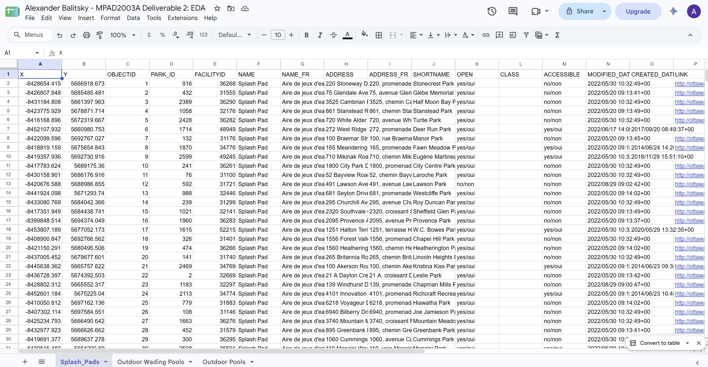
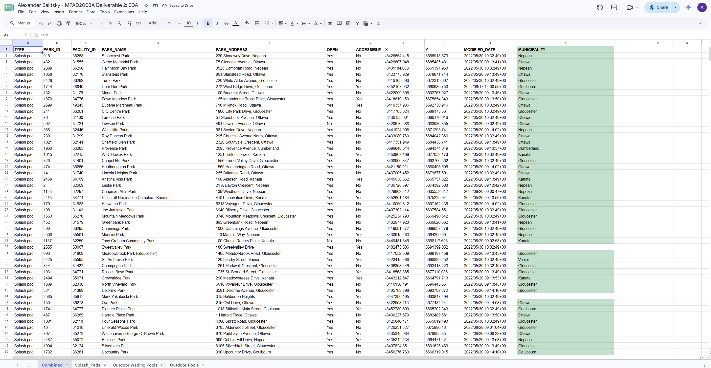
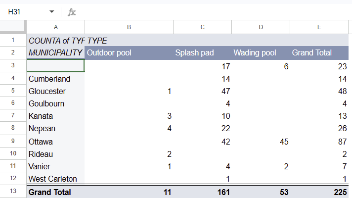
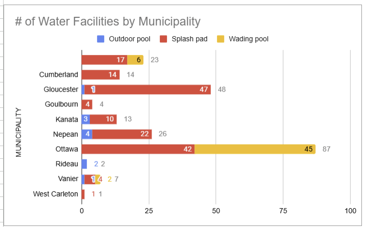

**November 5th 2026** 
**MPAD2003A Introductory Data Storytelling** 
**Alexander Balitsky** 
**Presented to Jean-Sébastien Marier** 

# Deliverable 2: Exploratory Data Analysis (EDA)

## 1. Getting Data
For this exploratory data analysis, I'll be analyzing 3 City of Ottawa datasets about outdoor water facilities. This includes outdoor pools, wading pools, and splash pads (City of Ottawa, 2022a, 2022b, 2024). 

**Original Datasets**
[Outdoor Pools Dataset](https://open.ottawa.ca/datasets/909df725a735445cbed1ac82f0f9001f_10/explore)
[Outdoor Wading Pools Dataset](https://open.ottawa.ca/datasets/7a66e4301c60460c97f0d7c2830fb855_11/explore?location=45.272344%2C-75.773591%2C1)
[Splash Pads Dataset](https://open.ottawa.ca/datasets/1bb9d909a84540cf99e2ed2106c7cad5_18/explore?location=45.272344%2C-75.773591%2C1)

The way I went about importing this data into Google Sheets was to simply download the CSV files of each dataset, press *File>Import>Upload*, then select my first CSV file, followed by *"insert new sheet(s)"*, kept *"detect automatically"* for the separator, and repeated this for each file. 

***[Link to my Public Spreadsheet](https://docs.google.com/spreadsheets/d/1G--GYr34FMQL5pQnfjmRqWdeEZHLuaQNkMd06S7RDMU/edit?usp=sharing)*** 

*Figure 1: Screen capture of my dataset just after importation.*

**Observations**
All together the files have 225 rows: 11 outdoor pools, 53 wading pools, and 161 splash pads. Outdoor pools has 23 columns, wading pools 41, and splash pads 25. The data itself isn't very clean, numerous text columns have a french equivalent (ex. NAME_FR, ADDRESS_FR), and a lot of columns are just empty or full of blank spaces.

- The "OPEN" column, which is shared by all 3 data sets, is a nominal (binary) variable which in this case is stored bilingually as a "yes/oui", "no/non". All 11 of the outdoor pools are listed as "no/non" which as somewhat surprising as this data was last modified in late august and early september of 2022.
- "PARKADDRESS", which is also shared by all 3 data sets, is also a nominal text variable. When a former municipality is listed it is placed at the end of the address (ex. ...Kanata, ...Gloucester), but 43 of the 161 splash pad addresses leave that part out.
- The "X" and "Y" columns are continuous variables that are measured in metres in the Web Mercator system, for example, "X -8,424,589, Y 5,657,945" instead of longitude and latitude. 

Based on the raw data I think it goes without saying that the type of facility somebody can access highly depends on where they live, as a lot of wading pools cluster more towards the downtown area while splash pads and outdoor pools sit further out and around the city.

## 2. Understanding Data

### 2.1. VIMO Analysis

For this VIMO analysis, I'd say the key takeaways would be to focus more on the variables previously discussed, the OPEN, PARKNAME/ADDRESS, and X/Y. Mostly because these display whether or not a water facility is open and where it sits geographically, which are the most important things to know for my story.

**Valid**
The "FACILITYID" variable is unique in all 3 files, and every single "X" and "Y" point falls inside of Ottawa.

**Invalid**
In row 115 of splash pads, there is a typo with "Paul Anka Drive" being spelt as "Paul Anda Drive" under the "ADDRESS" column. Again, all 11 outdoor pools say no/non under the "OPEN" and "ACCESSIBLE" columns.

**Missing**
17 splash pads and 6 wading pools have no former municipality in either address field. The Miikana Park splash pad is marked as "FUTURE" in the "OPEN" column. "LINK_DESCRIPTION" and "LINK_DESCRIPTION_FR" are both empty across all datasets, "CREATED_DATE" is partially filled out in the splash pads dataset (missing 107 entries), and completely empty in the others. "CLASS" is also entirely empty in the splash pads dataset. 

**Outliers**
The westernmost point is the Huntley Community Centre splash pad, and the easternmost is the Cumberland Millennium Sports Park splash pad. Both of these are plausible data points, so there wasn't any need to remove them. West Carleton only appears once but it isn't really an outlier of any significance.

### 2.2. Cleaning Data
- The first thing I did was combine all three datasets into one combined dataset while keeping the shared/relevant columns only (TYPE, PARK_ID, FACILITY_ID, PARK_NAME, ADDRESS, PARK_ADDRESS, OPEN, ACCESSIBLE, X, Y, & MODIFIED_DATE) and deleting the rest.
- Right after that, I spaced out the columns to improve legibility. 
- I reorganized the columns so that the type would come first, instead of the coordinates.
- Capitalized "TYPE" from "Type" to match the rest of the columns. 
- I also used the *"find and replace"* tool (Edit > Find and Replace) to remove all French translations and just keep the English ones (yes/oui to yes, no/non to no) as this isn't really needed for my analysis (Marier, 2026a). 
- Seeing as "ADDRESS" and "PARKADDRESS" were basically the same thing I combined both of them manually to display the most accurate addresses.
- Similarly, I found the "NAME" column to be rather irrelevant as it would either just list the "TYPE" on its own or in combination with the "PARKNAME" column, so removing it was the most reasonable option.
- Added underscores (_) to indicate spaces between column titles as some had them but some didn't, just to keep the formatting consistent.
- Bolded column titles to visually separate them from the data itself.
- Line 160 of the splash pads dataset had a formatting error that caused it to take up 2 rows, so I fixed that by using *"Trim whitespace"* (Data > Data clean-up > Trim whitespace) which removed whitespace from 2 cells (Marier, 2026a).
- Horizontally left aligned "X", "Y", "PARK_ID", "FACILITY_ID" columns to match the rest.
- I used the function `=IFERROR(TRIM(INDEX(SPLIT(E2, ","), 1, 2)), "")` to separate the municipality from the address in column E and placed it into column K.

*Figure 2: Screen capture of my dataset right after cleaning.*

### 2.3. Analyzing Data

I chose "TYPE" and the "MUNICIPALITY" columns for the pivot table (Insert > Pivot table) as there wasn't any specific ward field so the municipality data is the closest I can get to that. 

 
*Figure 3: This pivot table shows facilities by municipality and type. Created with aid from (Marier, 2026b)*

(Insert > Chart)
 
*Figure 4: The number of water facilities by municipality. Visualized with aid from (Statistics Canada, 2023)*

**Key Findings**
- Out of the 225 facilities, 161 are splash pads (71.6%), 53 are wading pools (23.6%), and 11 are outdoor pools (4.8%).
- The "Ottawa" municipality has the most facilities at 87 (38.7%): 45 wading pools, 42 splash pads, and no outdoor pools. 
- Wading pools are almost completely absent from every municipality except for the ones under "Ottawa". There are 45 in "Ottawa", 6 left blank, and only 2 listed in Vanier.
- Splash pads appear across all municipalities, except for Rideau.

I think it's important to note that, although combing through the provided data was informational, the missing entries and those simply labeled as "Ottawa" would have to be examined further and manually entered to get an exact location. However I think making use of the X and Y coordinates to plot on a map will be much more efficient to get a better scope of things in the future. 

## 3. Delivering Data
I still need to look at population by neighbourhood in Ottawa and dive deeper into the Neighbourhood Equity Index (NEI) scores to see if there is any correlation to find there (Social Planning Council of Ottawa, 2024). I'd also look further into sections 5.4 and 5.6 of the facilities master plan. Then I can work towards the story of whether or not the distribution of water facilities across the city tells us how accessible they are depending on where you live.

A possible interviewee could include someone from the city of Ottawa parks and recreation that manages or oversees water facility related issues. It could also possibly be a councillor or representative from a ward that could give more insight into these water facilities.

After a bit of research, some sources that could possibly help me provide more context to my story would include:
- The city of Ottawa's parks and recreation facilities master plan (City of Ottawa, 2021). 
- The city of Ottawa's engage Ottawa website which lists future projects including all splash pads (City of Ottawa, n.d.).

## 4. References
City of Ottawa. (n.d.). *All projects*. Engage Ottawa. Retrieved November 5, 2026, from https://engage.ottawa.ca/projects

City of Ottawa. (2021). *Parks and recreation facilities master plan*. https://documents.ottawa.ca/sites/default/files/MasterPlan_parks_and_facilities-en.pdf

City of Ottawa. (2022a). *Outdoor pools / Piscines extérieure* [Data set]. Open Ottawa. https://open.ottawa.ca/datasets/909df725a735445cbed1ac82f0f9001f_10/explore

City of Ottawa. (2022b). *Splash pads / Aire de jeux d'eau* [Data set]. Open Ottawa. https://open.ottawa.ca/datasets/1bb9d909a84540cf99e2ed2106c7cad5_18/explore

City of Ottawa. (2024). *Outdoor wading pools / Pataugeoires extérieure* [Data set]. Open Ottawa. https://open.ottawa.ca/datasets/7a66e4301c60460c97f0d7c2830fb855_11/explore

Marier, J.-S. (2026a). *Cleaning data in Google Sheets* [Video]. In *Module 6: Cleaning & reformatting a dataset*. Brightspace, Carleton University. https://brightspace.carleton.ca

Marier, J.-S. (2026b). *Using pivot tables in Google Sheets* [Video]. In *Module 7: Finding a story*. Brightspace, Carleton University. https://brightspace.carleton.ca

Social Planning Council of Ottawa. (2024). *Ottawa Neighbourhood Equity Index*. Retrieved October 8, 2026, from https://neighbourhoodequity.ca

Statistics Canada. (2023). *Data visualization: Best practices* (Catalogue no. 89-26-0005). https://www150.statcan.gc.ca/n1/pub/89-26-0005/892600052022001-eng.htm